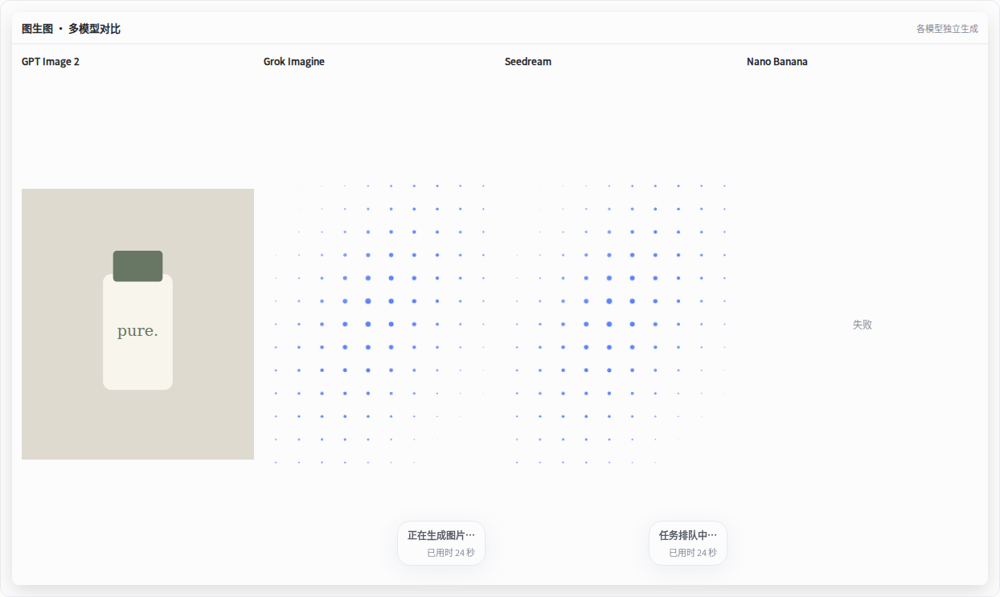
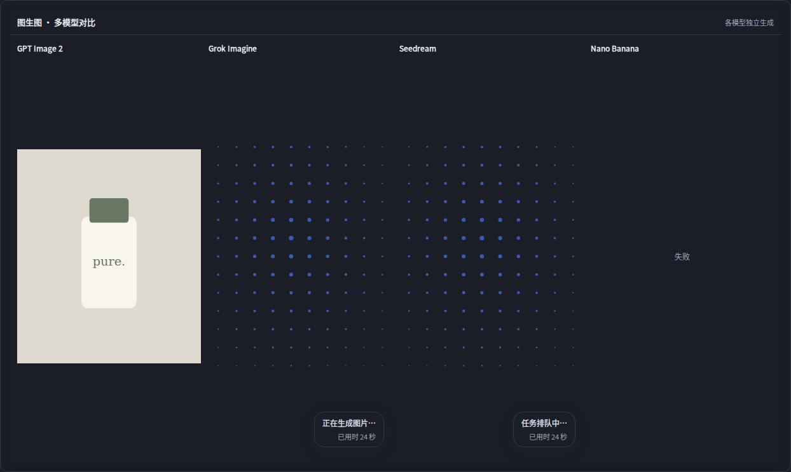

# 多模型对比点阵动画修复

原普通等待区以comparison===null为条件，而多模型对比使用独立comparisonBoard，仅显示状态文字，遗漏了动画接入。

现在排队/生成中的每个模型卡片独立挂载GenerationLoading；完成图片不被全局等待状态覆盖，失败和取消显示终态。每个卡片耗时从自身startedAt/createdAt计算。紧凑点阵每卡130个圆点，单模型仍保留原475点。对比区行高设置至少200px，修复手机多行卡片等待区域被压成零高度的问题。

截图来自实际动画与对比区CSS的本地夹具，图片及24秒文案仅为示例；实际面板使用真实任务数据。测试未调用付费模型。

验证包含完整smoke实际面板：文生图/图生图分别提交两个模型，验证排队均动画、部分完成保留图片、另一模型继续、失败取消停止、全部完成移除动画。Chromium覆盖单模型及2/4模型、两种模式、三种视口、混合状态、深色和减少动态效果，并检查每张卡片动画实际有可见宽高。

此补丁作为1.8.3发布，覆盖文生图、图生图多模型对比的独立点阵动画。
