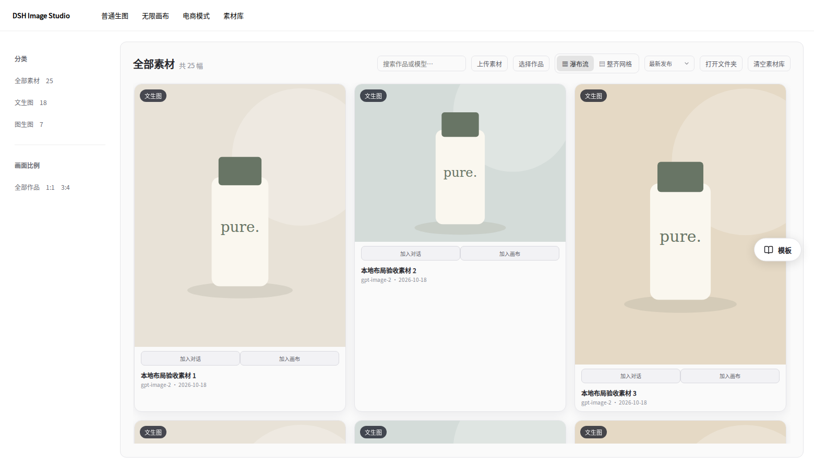
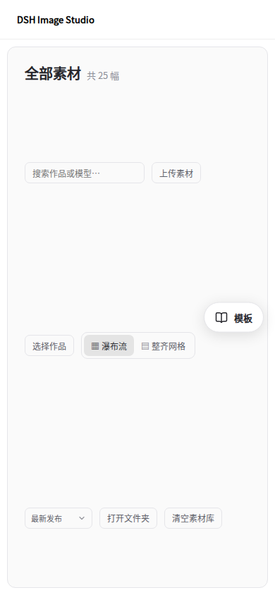

# 1.8.1 素材库布局审核

素材库排序原本使用共享Select的field默认尺寸（width:100%），占满一行，将其余操作挤到额外行。此次使用toolbar变体，限定紧凑宽度，并让操作区充分利用剩余空间。标题与操作区在宽度不足时换行；操作区内部自然换行，保留现有排序、视图、上传和清空行为。

模板悬浮按钮以工作区为定位范围，top:50%配合translateY(-50%)垂直居中，手机端不再覆盖成底部定位。

截图外围与素材为本地夹具，使用实际gallery样式、Select和TemplateLibraryButton。Chromium先复现排序占满一行的问题，再覆盖1560/1100/900/390px视口，验证紧凑排序宽度、宽屏单行对齐、无水平越界、排序与焦点恢复、素材滚动及入口精确居中。原完整smoke回归增加实际素材库排序variant检查。

本文归档1.8.1合并前的审核与验证结果。正式安装方式见[1.8.1发布说明](releases/v1.8.1.md)。
