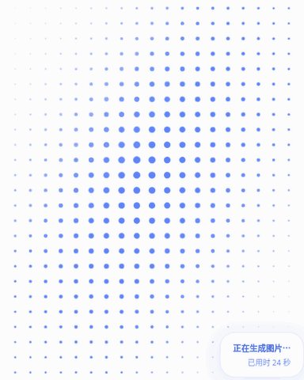

# 生成等待点阵动画

文生图与图生图共用蓝色点阵波纹，替换右侧等待区的大转圈。圆点错峰缩放并改变透明度，右下角展示真实提交/排队/生成状态及耗时，不模拟百分比。

- 仅生成等待状态挂载；完成后沿用现有结果区，失败和取消沿用原状态处理。
- SVG + CSS 动画，无新增依赖、无逐帧 JavaScript 定时器。装饰 SVG 对辅助技术隐藏，原有任务状态区域保留。
- 随容器缩放，使用宿主背景与文字色；减少动态效果时展示静态点阵。
- 本分支仅改动等待动画；未改整体视觉风格、请求协议、模型适配或生成流程，未修改版本号或发布。



动图和截图由实际组件的本地浏览器夹具录制；“24秒”是夹具文案，正式面板继续使用真实任务计时。

验证：类型检查、构建及83项完整回归通过。面板回归覆盖文生图/图生图动画挂载、无虚假百分比、任务完成卸载并显示结果。Chromium验证实际点阵运动，以及提交/排队/生成与终态、桌面/手机/短视口、深色和减少动态效果。

复现浏览器检查：

```bash
pnpm exec tsdown --config scripts/generation-preview.config.ts
node scripts/generation-browser-test.mjs
```

可选环境变量：`GENERATION_CHROMIUM_PATH` 指向本地Chromium、`GENERATION_FONT` 指向中文字体、`GENERATION_FRAME_DIR` 保存动图原始帧。
