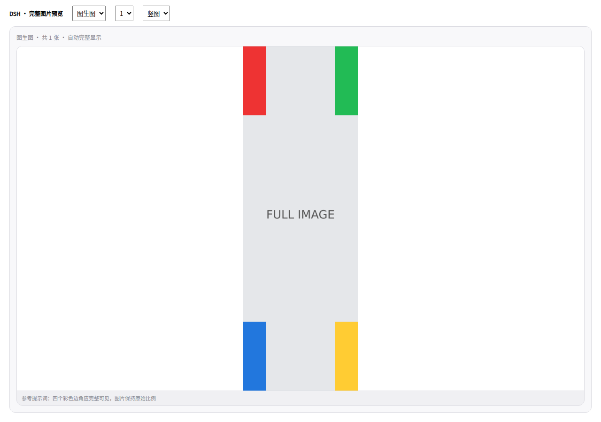
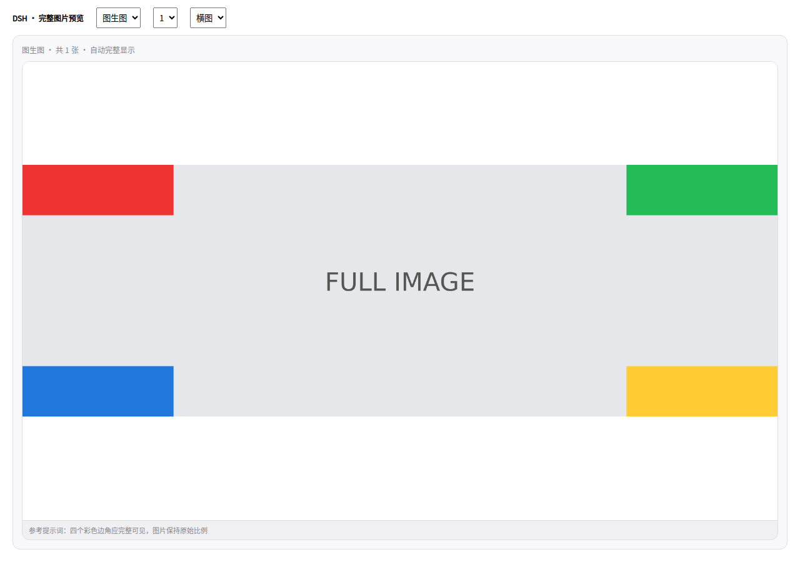

# #41 与普通生图预览修复审核

审核分支：`feat/template-drawer`。未合并 main、未发布 npm / GitHub Release，包内版本号保持1.7.0。此审核包也包含此前的模板库大抽屉和图生图多图上传。

## #41：桌面端更新失败

- 优先使用宿主 `profileContext` 提供的名称和目录，再读取 `DSH_PROFILE`、`--profile name` / `--profile=name`、argv中的 `profiles/<name>` 路径。支持Windows路径。
- 检测到desktop profile、Electron或desktop-host启动形态时，在启动子进程前阻止错误的CLI更新。检查更新的响应提供profile和更新方式，客户端显示桌面端说明，停用不适用的「在线更新」。直接请求更新接口同样受到检查。
- Web/CLI保留原有 `dsh plugin --profile ... add ...` 安装方式。失败时收集有界的stdout/stderr尾部、实际命令、profile、退出码或启动失败原因；识别 `ERR_PNPM_UNEXPECTED_STORE` 并说明应匹配原pnpm版本和store。
- 面板展示实际错误；诊断记录进入现有「接口诊断」列表的更新记录。日志限制长度并遮盖凭据，未通过自动切换store、删除锁文件或强制重装来处理问题。
- 子进程输出按close事件收集，避免exit已触发而stderr尚未读完；异常启动与超时也有诊断。

### 桌面端更新说明

本次修复桌面端错误调用和不可诊断的失败路径。当前DSH的插件管理接口对运行中的已安装bundle有自身管理限制，插件不会通过卸载自己来尝试热更新。

优先使用DSH桌面应用支持的插件管理流程。若宿主暂无更新入口，可参照issue作者验证的手动安装方式：

1. 完全退出DSH桌面应用。
2. 在当前profile目录检查 `node_modules/.modules.yaml` 的 `packageManager` 和 `storeDir`。
3. 使用创建该profile时相同版本、相同store的pnpm，在profile目录安装所需的 `@dickpy/dsh-imagegen@<版本>`。
4. 重新启动桌面应用。

不要把 `dsh plugin --profile desktop ...` 当作桌面端更新途径。宿主自带pnpm可从启动参数或桌面安装目录确认；这份修复不会调用PATH上的随机pnpm去改写desktop profile。

参考：[issue #41](https://github.com/dickpy/dsh-imagegen/issues/41)。

## 文生图 / 图生图右侧预览

旧结果区使用 `object-fit: cover`，图片比例和卡片比例不一致时会裁掉四周。现在按可用空间使用 `contain` 完整显示，保持原始比例，并为图片约束flex尺寸、为说明文字保留空间。点击放大功能保留。

截图采用实际结果区CSS，本地测试图片的四个彩色边角用于检查内容完整性，外围是测试夹具。





## 验证结果

- `pnpm typecheck`、`pnpm build`。
- `node scripts/smoke.mjs`：83项通过。新增桌面真实argv与Windows路径、宿主profile优先级、桌面禁止spawn、CLI成功/非零退出/启动异常、退出后stderr、store不匹配提示、日志脱敏、检查接口更新方式，以及客户端错误和桌面说明检查；原有生图、模板、电商、画布、多参考图、海报回归继续通过。
- Chromium：先复现旧cover裁边，再逐像素检查图片四个彩色边角。文生图/图生图、横/竖/方图、单张/2张/4张、不同视口共54种组合全部完整可见，图片未溢出卡片。
- 本地tgz打包与内容验证；未执行真实升级、未调用付费模型。未在macOS Electron实体应用内做安装测试。

浏览器复验：

```bash
pnpm exec tsdown --config scripts/result-preview.config.ts
node scripts/result-preview-browser-test.mjs
```

可用 `RESULT_CHROMIUM_PATH` 指定Chromium，`RESULT_PREVIEW_FONT` 指定截图中文字体。
