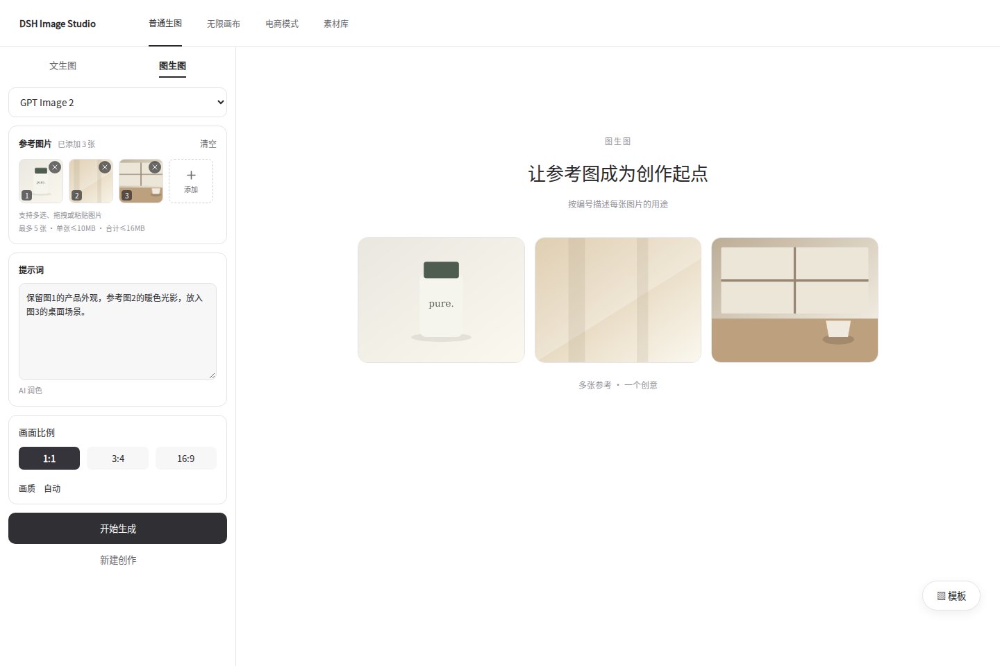
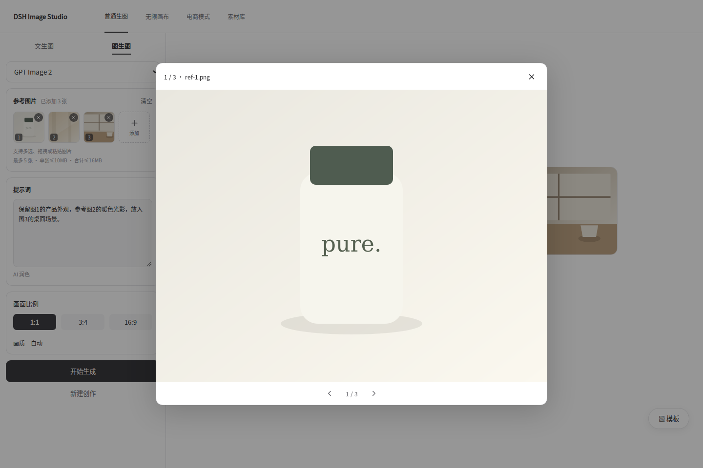
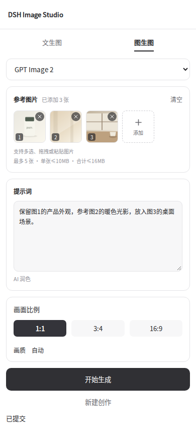
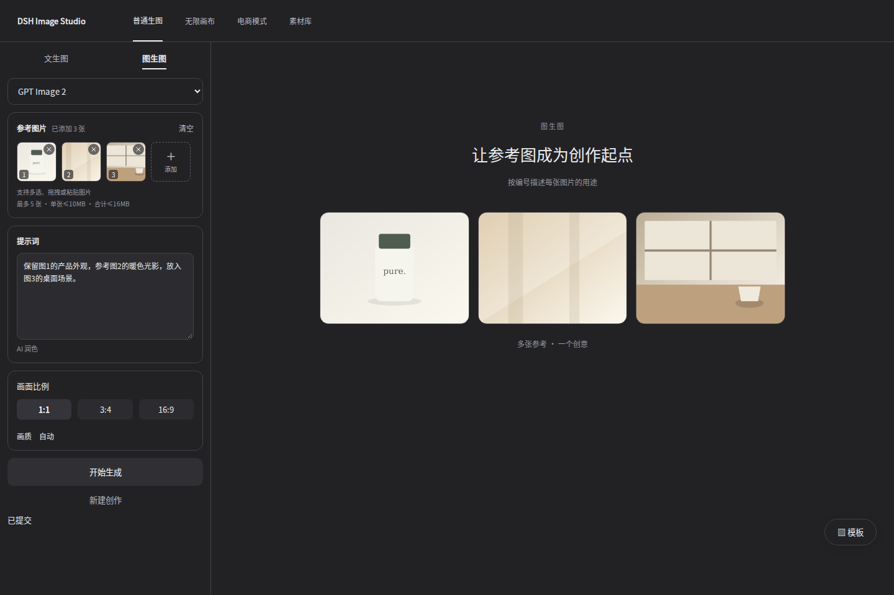

# 图生图多图上传审核版

版本归档：以下记录 v1.8.0 合并前的审核内容与验证结果；正式安装与升级方式见 [v1.8.0 更新说明](releases/v1.8.0.md)。

## 更新内容

- 普通「图生图」支持一次选择多张图片，也可分批追加、拖拽或粘贴。提示词区域粘贴图片同样可追加，普通文字粘贴保持原有行为。
- 上传后显示约 64×64 像素的小缩略图，空间不足自动换行。图片按选择顺序编号，右上角删除，末尾「＋」继续添加，支持一键清空。
- 点击缩略图查看大图，支持左右切换、键盘方向键、Escape 关闭并恢复焦点。
- 多图请求沿用现有后端格式：第1张为主图，其余为额外参考图；只有1张时保持原有单图传参。读取完成顺序不会改变图片顺序。
- 清空或新建创作会取消待处理结果，防止读取中的图片重新出现。现有模板库、图生图提示词保留和「结果转图生图」入口继续可用。
- 当前上限与后端保持一致：最多5张，单张≤10MB，合计≤16MB；PNG / JPG / WEBP / GIF。合计大小限制为现有24MiB JSON请求上限预留base64空间。超出或读取失败会明确提示，有效图片继续保留。
- 根据所选通道、模型别名映射、协议和现有适配检查参考图数量。若当前适配只传1张，上传多张后会明确提示并阻止提交；切换模型不会丢失已选图片。多模型对比按所选适配的最小上限检查。

这次复用现有模型适配，没有改写生图引擎或发布流程。可上传5张不代表任意第三方网关均支持5张，实际模型生成仍需在用户自己的提供方环境中验收。

## 实际组件截图

截图使用本次实现的 ReferenceImages 组件、上传状态逻辑和样式。外围工作区、示例图片和提交接口为本地测试夹具，不会调用付费模型。









## 验证

- `pnpm typecheck`、`pnpm build`。
- `node scripts/smoke.mjs`：80项通过；补充真实普通图生图表单的多图上传、顺序、删除、预览、主图+额外参考图提交、单图格式兼容、新建清空检查。模板库、电商、画布、海报等原有回归继续通过。
- `scripts/references-browser-test.mjs`：Chromium验证64像素缩略图、追加/顺序、反序完成与分批读取、清空时取消、删除/重编号、拖拽/粘贴、普通文字粘贴、大图/键盘/焦点、适配检查、数量/单张/合计限制、部分读取失败、手机和深色样式。
- 本地npm tgz打包及内容校验；未执行发布。

浏览器检查：

```bash
pnpm exec tsdown --config scripts/references-preview.config.ts
node scripts/references-browser-test.mjs
```

需要可用的Playwright / Chromium；可用 `REFERENCES_CHROMIUM_PATH` 指定浏览器，`REFERENCES_PREVIEW_FONT` 指定截图中文字体。

## 安装审核包

下载本次审核tgz后运行：

```bash
dsh plugin --profile web add ./dsh-imagegen-multi-reference-review.tgz
```

重启 `dsh web` 后，在「普通生图 → 图生图」中审核。此包包含此前的模板库大抽屉，包内版本号仍为1.7.0，尚未发布到npm。
