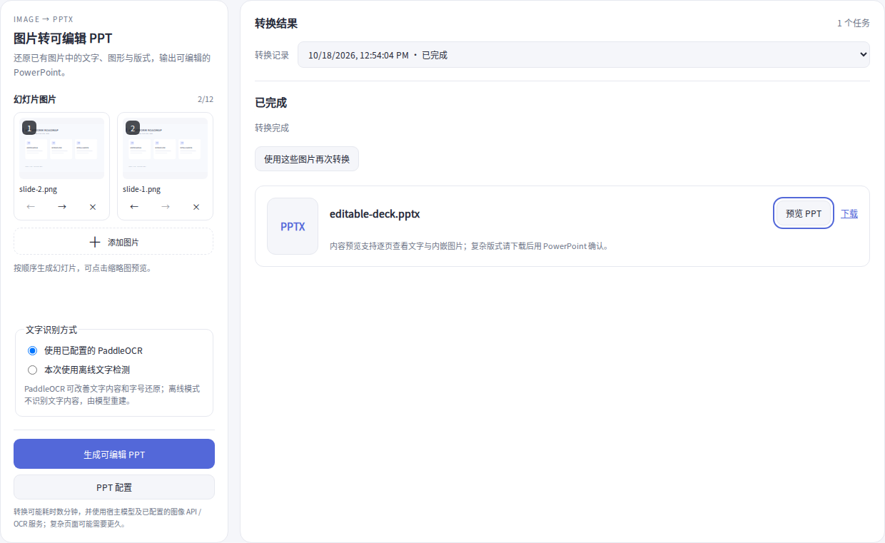
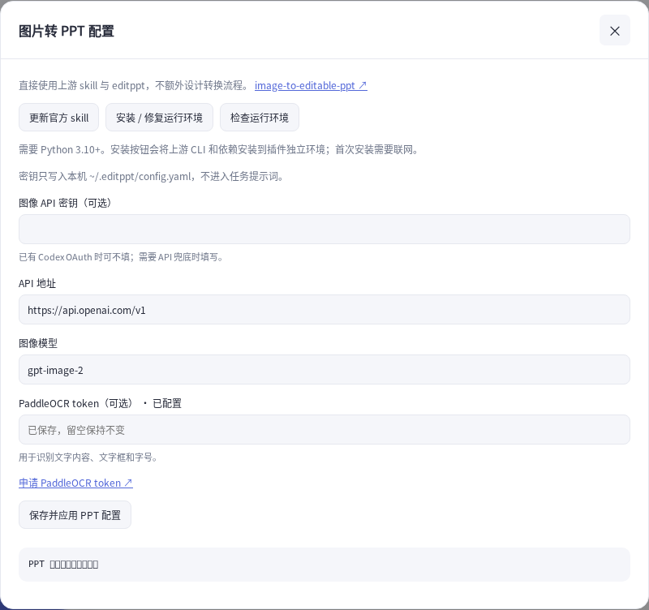

# PPT 模式修复 · 1.9.1 审核

用户截图展示「未输出最终PPTX」、配置按钮无响应，以及上传图片后仍保留大上传区。本版针对运行交付与界面一起修复。

## 执行与交付

DSH 的 Agent 驱动在 kick 中容纳模型错误，whenIdle 可正常返回。旧插件只查看助手文字和输出文件，因而会将没有回复的失败覆盖为 noDeck。本版通过 Agent 错误事件和 session turn/end 读取具体原因并脱敏。不会将服务认证失败或模型额度不足伪装为已修复；此类信息会显示在任务卡片。

上游 editppt finalize 默认写 final/deck_edited.pptx、validation.json 和 run_summary.json，原插件只扫描自己的 output 目录。新增有边界的当前任务目录检查：status=complete、页数一致、validation.passed=true 且路径属于本任务时，才收集上游最终文件。PPTX 结构与页数检查仍保留。未验证的嵌套文件或单页中间产物不被视为成功。

参考读取时的 DSH 源码：packages/core/agent-loop/src/agent.ts 的 kick/whenIdle；上游 skill：cli/editppt/runtime/finalize_deck_run.py。原始 skill 未被修改。

## 界面

PPT配置在模式中直接打开弹窗，使用与生图配置同一组件与保存API。无须宿主存在特定文字或 aria 属性的设置按钮。

图片上传后，空状态上传区消失，显示缩略图和加号。桌面图片列表独立滚动，底部转换/配置操作保留可见；小屏可滚动使用。转换记录改为下拉，失败显示具体信息并支持重试。

## 验证范围

完整回归包含原有文生图/图生图、多图与多模型点阵；新增测试覆盖宿主含错误但正常结束、错误脱敏、上游final目录交付和拒绝未通过校验的结果。浏览器检查真实PPT组件的上传区消失、加号添加、排序、独立弹窗打开/关闭、配置保存、取消及390/800/1280宽度。

截图为真实组件和本地模拟数据，不是模型实际转换结果。用户本机的具体失败原因需由更新后显示的原始错误判断；真实Electron宿主及真实API转换未在本环境完成。本版未发布，等待审核。

补充：结果区只显示最终PPTX卡片，提供内容预览和下载；逐页内容预览使用现有PPTX解析器，不宣称像素级还原。隐藏源图和辅助图片。失败任务可打开诊断查看任务ID、执行Agent会话、运行目录及错误；旧任务无法恢复当时未记录的原始错误，需要DSH对应时间日志。
