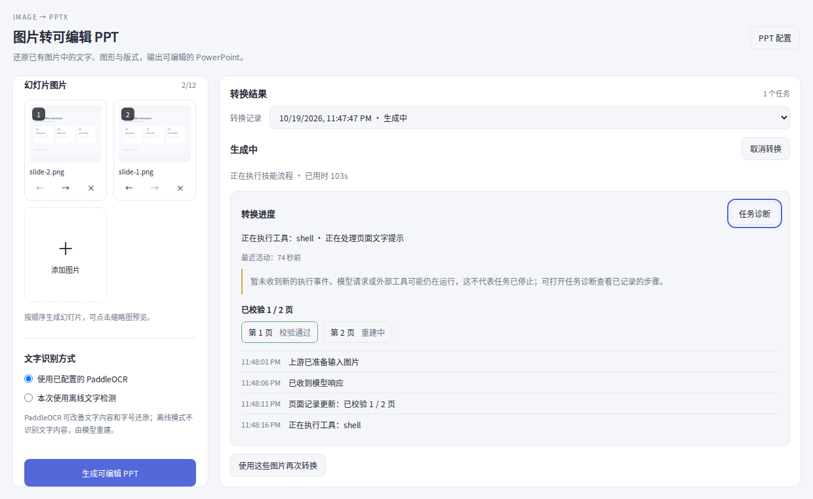

# PPT 保存与可观测性 · 1.9.3 审核

用户提供 Windows 任务 JSON 临时文件 rename 到已有目标时的 EPERM，并反馈执行数分钟只能看见“技能执行中”。仅凭报错无法确定是杀毒软件、索引器、宿主并发还是文件 ACL 占用；已确认旧代码必须替换同一任务文件，且任一状态写入错误会阻止 Agent 启动，或通过 job.catch 把完成状态改成 failed。

## 保存修复

PptTaskStore 将队列时的状态立即序列化成不可变快照，每任务按顺序写入新的时间戳/UUID 文件，使用 wx 和 flush，不替换或删除旧任务记录。每次运行只在入队、记录 Agent 身份、终态或取消时保存，进度轮询不写盘。历史读取同时支持旧 JSON 与新快照，忽略截断/无效文件，返回每任务最新完整记录。保留较早快照用于恢复；不会消费旧版本遗留的未提交 .tmp 文件。

最初的入队记录仍必须保存成功才启动工作，避免在任务完全无法记录时偷偷启动收费请求。后续保存失败只设置 persistenceError，不取消 Agent，不替换真正的转换错误，也不撤销成功产物。读取历史失败时，已在本进程运行的任务仍能返回。页面显示独立警告，并在诊断中保存脱敏错误。

故障注入验证：模拟旧目标 rename 必定 EPERM，检查新存储根本不调用 rename；交叠写入保持 queued→running→completed 快照顺序；不完整更新不掩盖上一份完整记录。Runner 检查开始后持续写入失败时仍能交付 PPT，真正的转换错误仍保留，读目录失败仍返回当前结果。

## 真实进度

仅消费 DSH session 的 step/start、tool/call、tool/result、assistant/message 的事件类型及工具名，不读取模型文本/思考和工具输出。命令参数只在内存中分类已知 editppt CLI 操作，页面仅展示固定操作标签，不回传参数。事件环限制40条，工具关联限制128个，扫描每次最多512个会话事件。

只在当前任务目录内有界查找上游 page_jobs.json 和 run_state.json；跳过符号链接、输入/页面资源/虚拟环境目录，文件限制512KB，扫描限制1000项与6级。页数必须与输入数一致，仅 recorded/accepted 且 result.validation_passed=true 的页计为通过。上游完成不直接将插件任务标记成功，仍须原有最终 PPTX 收集和校验通过。

最近活动时间只随真实状态变化更新，重复轮询不会伪造进展。长时间无事件给出中性提示，不用时间推算百分比，也不把工具返回错误直接视作整个任务失败。运行中可查看诊断；完成后记录折叠，保留 PPT 预览。

验证包含：模型/工具事件、可识别 CLI 操作、页面校验数量、重复扫描无假进度、停机后不再更新、不泄露命令密钥/模型思考/工具输出。Chromium 检查运行中进度、无活动提示、诊断、取消、配置、多页预览、预览重试与390/800/1280/1920视口。

截图为真实组件与本地示例数据。本环境没有用户 Windows 宿主和真实模型凭据，不能把以上回归说成已在用户机器上完成转换。尚未发布。
